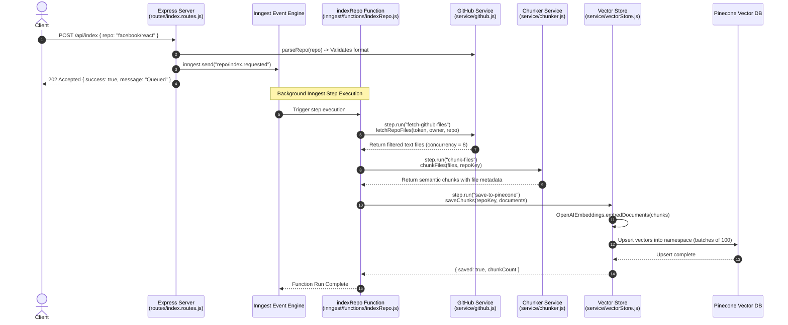
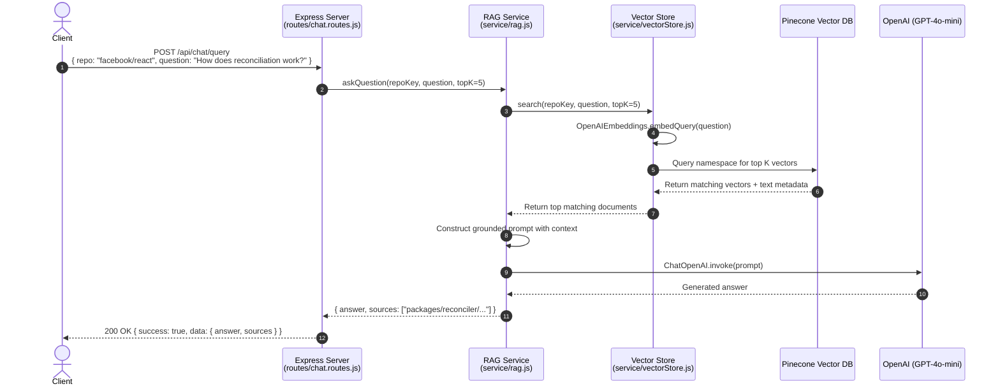

# 📚 Git Wiki Repo Chat

> An intelligent, production-grade **Retrieval-Augmented Generation (RAG)** service that transforms any GitHub repository into an interactive AI knowledge base. Ingest codebases, embed documentation into Pinecone, and ask complex codebase questions with answers grounded directly in the source code.

---

## 📌 What It Is

**Git Wiki Repo Chat** is a backend AI application built with **Node.js (ES Modules)**, **Express**, **Inngest**, **LangChain**, **Pinecone**, and **OpenAI**. 

It solves the problem of understanding large or unfamiliar codebases by allowing developers, AI agents, and users to query a GitHub repository in plain English. The application indexes repository code and wiki documentation into a vector database and uses an LLM to generate precise, grounded answers accompanied by file citations.

---

## ⚡ What It Does

1. **On-Demand Repository Ingestion**:
   - Accepts any public or private GitHub repository URL or `owner/repo` identifier.
   - Fetches repository tree hierarchies directly from the GitHub API using `@octokit/rest`.
   
2. **Smart Content Filtering**:
   - Skips non-code assets, media (`png`, `svg`, `mp4`, etc.), compiled binaries (`dll`, `wasm`, `jar`), lockfiles (`package-lock.json`, `Cargo.lock`), minified bundles, and dependencies (`node_modules`, `dist`, `.git`).
   - Ignores oversized files (>200 KB) to optimize embedding performance and token consumption.

3. **High-Performance Chunking & Hashing**:
   - Splits code and markdown files into overlapping text chunks using LangChain's `RecursiveCharacterTextSplitter`.
   - Computes deterministic SHA-256 hashes (`repo:filepath:content`) for every chunk to prevent duplicate vector entries.

4. **Isolated Vector Storage**:
   - Embeds chunks using OpenAI's `text-embedding-3-small` model.
   - Upserts vectors into dedicated **Pinecone namespaces** scoped per repository (`owner-repo`), preventing cross-repository search contamination.

5. **Durable Background Job Orchestration**:
   - Uses **Inngest** step functions to orchestrate multi-step ingestion and question workflows with automatic retries, backoff, and durability—preventing HTTP request timeouts on large repositories.

6. **Flexible Q&A (Async & Sync)**:
   - **Asynchronous Chat**: Queue questions to Inngest for background processing and webhook notifications.
   - **Synchronous Chat**: Query the repository directly via `/api/chat/query` for instant answers and cited source paths.

---

## 🔄 Detailed Code Flow

### 1. Ingestion Pipeline (`POST /api/index`)

This pipeline handles cloning metadata, fetching files concurrently, chunking code, embedding, and vector storage.



#### Step-by-Step Code Flow:
1. **Request Intake**: `POST /api/index` receives `{ repo, githubToken }`.
2. **Validation**: `parseRepo(repo)` in [`src/service/github.js`](file:///c:/Users/mohammed-saif/Desktop/cohort/projects/genai/git-wiki-repo-chat/src/service/github.js) sanitizes and validates the repository name (e.g., `facebook/react`).
3. **Event Dispatch**: Express publishes the `repo/index.requested` event to Inngest and immediately returns `202 Accepted`.
4. **Step 1 - File Retrieval (`fetchRepoFiles`)**: Inngest triggers the `indexRepo` function. Octokit retrieves the repository tree, skips binaries/lockfiles, and fetches up to 200 eligible text files in concurrent batches of 8.
5. **Step 2 - Text Chunking (`chunkFiles`)**: [`src/service/chunker.js`](file:///c:/Users/mohammed-saif/Desktop/cohort/projects/genai/git-wiki-repo-chat/src/service/chunker.js) breaks files into 1000-character chunks with a 150-character overlap, attaching file path metadata.
6. **Step 3 - Embed & Upsert (`saveChunks`)**: [`src/service/vectorStore.js`](file:///c:/Users/mohammed-saif/Desktop/cohort/projects/genai/git-wiki-repo-chat/src/service/vectorStore.js) embeds chunk texts using `text-embedding-3-small`, generates deterministic SHA-256 IDs, and upserts them into the Pinecone repository namespace in batches of 100.

---

### 2. Chat & RAG Query Pipeline (`POST /api/chat` or `POST /api/chat/query`)

This pipeline retrieves relevant code snippets and synthesizes an answer using an LLM.



#### Step-by-Step Code Flow:
1. **Query Input**: Client sends `repo` and `question`.
2. **Embedding the Query**: In [`src/service/vectorStore.js`](file:///c:/Users/mohammed-saif/Desktop/cohort/projects/genai/git-wiki-repo-chat/src/service/vectorStore.js), the user's question is embedded into a 1536-dimensional vector using `text-embedding-3-small`.
3. **Vector Similarity Search**: Pinecone queries the target repository namespace and retrieves the top 5 most semantically similar code snippets.
4. **Context Assembly**: In [`src/service/rag.js`](file:///c:/Users/mohammed-saif/Desktop/cohort/projects/genai/git-wiki-repo-chat/src/service/rag.js), matching code chunks and their respective file paths are formatted into a structured prompt.
5. **Answer Generation**: OpenAI `gpt-4o-mini` produces a concise, accurate answer constrained strictly to the provided repository context.
6. **Response Delivery**: The API returns the answer along with a deduplicated list of source file paths.

---

## 🛠️ Tech Stack & Key Components

| Technology | Purpose |
| :--- | :--- |
| **Node.js (ESM)** | Modern JavaScript runtime using native ES Modules (`import`/`export`). |
| **Express 5** | REST API framework enhanced with `helmet`, `cors`, and centralized error handling. |
| **Inngest** | Event-driven serverless orchestration engine for background workflows and retries. |
| **Octokit (`@octokit/rest`)** | Official GitHub REST client for repository trees and blob contents. |
| **LangChain (`@langchain/textsplitters`)** | Recursive chunking aware of natural code and markdown boundaries. |
| **Pinecone (`@pinecone-database/pinecone`)** | Managed serverless vector database with per-repo namespace isolation. |
| **OpenAI (`@langchain/openai`)** | `text-embedding-3-small` for vector representations and `gpt-4o-mini` for RAG responses. |

---

## 📂 Project Directory Structure

```text
git-wiki-repo-chat/
├── src/
│   ├── config/
│   │   └── env.js                   # Centralized environment configuration and validation
│   ├── inngest/
│   │   ├── functions/
│   │   │   ├── askQuestions.js      # Inngest background function for chat jobs
│   │   │   ├── helloWorld.js        # Health check test event function
│   │   │   └── indexRepo.js         # Durable multi-step repository indexing function
│   │   ├── client.js                # Inngest client initialization with unique app ID
│   │   └── index.js                 # Function registry exported to Inngest serve handler
│   ├── routes/
│   │   ├── chat.routes.js           # POST /api/chat (async) & POST /api/chat/query (sync)
│   │   └── index.routes.js          # POST /api/index (repo ingestion trigger)
│   ├── service/
│   │   ├── chunker.js               # Recursive text chunking with metadata tagging
│   │   ├── github.js                # GitHub URL parsing, filtering, and concurrent blob fetching
│   │   ├── rag.js                   # RAG prompt construction and ChatOpenAI answer generation
│   │   └── vectorStore.js           # Pinecone client, SHA-256 deduplication, and vector search
│   └── index.js                     # Express setup, security middleware, and graceful shutdown
├── .env.example                     # Documented template for environment variables
├── package.json                     # Dependencies, scripts (dev/start), and metadata
└── README.md                        # Documentation and architecture guide
```

---

## 🚀 Getting Started

### 1. Prerequisites

- **Node.js**: `v20.0.0` or higher
- **Pinecone Account**: An API key and a vector index (e.g. `git-wiki-repo-chat` with dimension `1536`, metric `cosine`)
- **OpenAI Account**: An API key with access to embeddings and chat models
- **GitHub Personal Access Token**: *(Optional)* Recommended to prevent GitHub API rate limits

### 2. Installation

Clone the repository and install dependencies:

```bash
git clone <repo-url>
cd git-wiki-repo-chat
npm install
```

### 3. Environment Configuration

Copy `.env.example` to `.env`:

```bash
cp .env.example .env
```

Populate the configuration:

```ini
PORT=3000
NODE_ENV=development
INNGEST_DEV=1

OPENAI_API_KEY=sk-proj-...
PINECONE_API_KEY=pcsk_...
PINECONE_INDEX=git-wiki-repo-chat
GITHUB_TOKEN=ghp_...
```

### 4. Running the Application

#### Start the Express Server:

```bash
# Development mode with file watching:
npm run dev

# Production mode:
npm start
```

#### Start the Inngest Dev Server (for background event monitoring):

In a separate terminal window:

```bash
npx inngest-cli@latest dev -u http://localhost:3000/api/inngest
```

Open the Inngest dashboard at **[http://localhost:8288](http://localhost:8288)** to view active runs, payloads, step logs, and replay events.

---

## 📡 API Reference & Examples

### 1. Health Check
Checks service uptime and health.

```bash
curl -X GET http://localhost:3000/health
```

**Response (200 OK):**
```json
{
  "status": "ok",
  "uptime": 42,
  "timestamp": "2026-10-26T08:15:00.000Z"
}
```

---

### 2. Index a Repository (Asynchronous)
Triggers background cloning, parsing, chunking, and embedding.

```bash
curl -X POST http://localhost:3000/api/index \
  -H "Content-Type: application/json" \
  -d '{
    "repo": "facebook/react"
  }'
```

> **Accepted formats for `repo`**: `"owner/repo"`, `"https://github.com/owner/repo"`, or `"git@github.com:owner/repo.git"`.

**Response (202 Accepted):**
```json
{
  "success": true,
  "message": "Repository indexing job queued successfully.",
  "data": {
    "repo": "facebook/react",
    "owner": "facebook",
    "repoName": "react"
  }
}
```

---

### 3. Query Codebase (Synchronous Direct Response)
Instantly queries Pinecone and returns an LLM-synthesized answer with source citations.

```bash
curl -X POST http://localhost:3000/api/chat/query \
  -H "Content-Type: application/json" \
  -d '{
    "repo": "facebook/react",
    "question": "Where is the React Fiber reconciler loop defined?",
    "topK": 5
  }'
```

**Response (200 OK):**
```json
{
  "success": true,
  "data": {
    "answer": "The React Fiber reconciliation loop is implemented in `ReactFiberWorkLoop.js`. It contains the main work loop functions such as `workLoopSync` and `workLoopConcurrent` that iterate through the Fiber tree work units.",
    "sources": [
      "packages/react-reconciler/src/ReactFiberWorkLoop.js",
      "packages/react-reconciler/src/ReactFiberBeginWork.js"
    ],
    "repo": "facebook/react",
    "question": "Where is the React Fiber reconciler loop defined?"
  }
}
```

---

### 4. Queue a Question (Asynchronous Inngest Workflow)
Dispatches an Inngest question event for asynchronous background processing.

```bash
curl -X POST http://localhost:3000/api/chat \
  -H "Content-Type: application/json" \
  -d '{
    "repo": "facebook/react",
    "question": "Explain how hooks maintain internal state across renders."
  }'
```

**Response (202 Accepted):**
```json
{
  "success": true,
  "message": "Chat question queued successfully.",
  "data": {
    "repo": "facebook/react",
    "question": "Explain how hooks maintain internal state across renders."
  }
}
```

---

## 🛡️ License

ISC License
